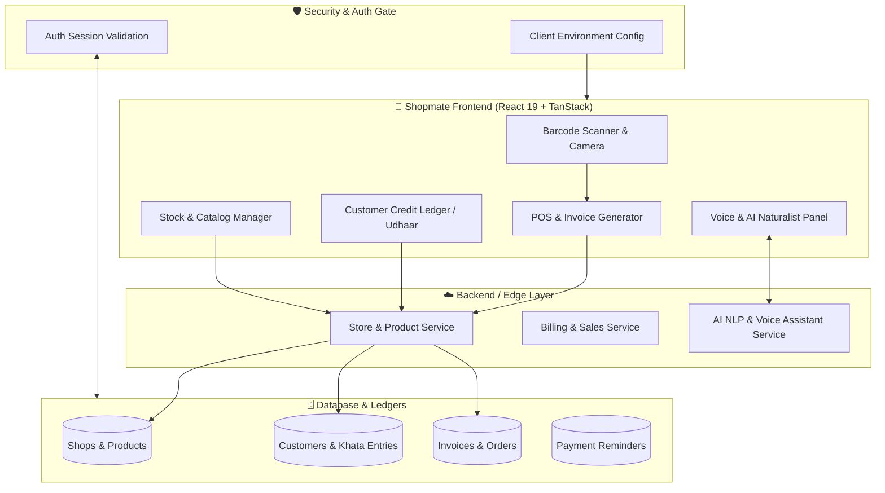

<h1 align="center">Shopmate AI</h1>
<h3 align="center">Next-Gen AI Retail & Smart Shop Management Platform</h3>

<p align="center">
  <strong>A comprehensive, mobile-first full-stack retail management web application built for modern shopkeepers and merchants. Features AI voice/chat workflow automation, instant barcode scanning, POS billing, customer udhari (khata) tracking, inventory control, and payment reminders.</strong>
</p>

<p align="center">
  
  
  
  
  
  
</p>

<p align="center">
  <a href="https://shopmateai.lovable.app" target="_blank">
    
  </a>
</p>

<p align="center">
  🔗 <strong>Live App URL:</strong> <a href="https://shopmateai.lovable.app" target="_blank">https://shopmateai.lovable.app</a>
</p>

---

## 📑 Table of Contents

- [Overview](#-overview)
- [System Architecture & Workflow](#-system-architecture--workflow)
- [Core Features](#-core-features)
- [Tech Stack](#-tech-stack)
- [Project Structure](#-project-structure)
- [Getting Started](#-getting-started)
  - [Prerequisites](#prerequisites)
  - [Installation](#1-clone--install-dependencies)
  - [Environment Configuration](#2-environment-setup)
  - [Backend Setup (Bring Your Own Backend)](#3-backend-setup)
  - [AI Assistant Setup (Bring Your Own AI)](#4-ai-assistant-setup-bring-your-own-ai)
  - [Running the App](#5-run-development-server)
  - [Production Build](#6-build-for-production)
- [Security & Privacy](#-security--privacy)
- [License](#-license)

---

## 🛍️ Overview

> 🌐 **Try the Live Application:** [https://shopmateai.lovable.app](https://shopmateai.lovable.app)

Running a retail shop involves balancing inventory, processing rapid customer queues, managing outstanding credits (udhari), and sending payment reminders. **Shopmate AI** replaces messy paper notebooks and clunky legacy software with a fast, mobile-friendly full-stack application that puts AI at the service of the shopkeeper.

### Key Value Propositions:
1. **AI Shopkeeper Assistant**: Speak naturally or type commands to add products, check stock, or draft orders hands-free.
2. **Barcode Scanner & Fast Billing**: Point phone camera at any product barcode to auto-populate name, unit, and price, generating a clean printable/shareable invoice in seconds.
3. **Digital Khata & Credit Ledger**: Track which customer owes how much, log partial repayments, and maintain clear transaction histories.
4. **Smart Reminders**: Set automated payment alerts and WhatsApp-ready reminder notifications for outstanding balances.
5. **Real-time Inventory & Sales Insights**: Monitor low-stock alerts, best-selling items, and daily revenue metrics.

---

## 📊 System Architecture & Workflow



---

## ✨ Core Features

| Module | Description | Capability |
| :--- | :--- | :--- |
| ⚡ **Barcode Scanner & POS Billing** | Instant camera-based barcode scanning to add line items and calculate taxes/discounts. | Rapid checkout & digital receipt generation |
| 📒 **Digital Khata (Customer Credit)** | Complete ledger tracking customer debts, partial payments, and net credit balances. | Transparent credit tracking with zero paper loss |
| 🤖 **AI Voice & Chat Assistant** | Hands-free natural language voice interface to query stock, create customer tabs, or record orders. | Conversational shop management |
| 📦 **Inventory Management** | Catalog management with SKU, barcode, unit, cost price, and auto-flagging of low stock. | Never run out of critical inventory |
| ⏰ **Payment Reminders** | Schedule payment due dates and generate quick payment reminder messages. | Improve cash collection speed |
| 📈 **Sales Analytics & Reports** | Daily, weekly, and monthly sales graphs with revenue breakdowns and top-selling items. | Actionable business intelligence |
| 📱 **Mobile & PWA Ready** | High-performance responsive UI optimized for single-handed mobile use on the shop floor. | Works on any phone, tablet, or PC |

---

## 🛠️ Tech Stack

- **Frontend Core**: [React 19](https://react.dev/) + [TanStack Router](https://tanstack.com/router)
- **Bundler & Build Tool**: [Vite 7](https://vitejs.dev/) + TypeScript
- **Styling**: [Tailwind CSS v4](https://tailwindcss.com/) with native design tokens and responsive utilities
- **UI Primitives**: [Radix UI](https://www.radix-ui.com/) accessible primitives + Lucide Icons + Recharts
- **Voice Capabilities**: Web Speech API (`SpeechRecognition` + `SpeechSynthesis`)
- **Notifications**: Sonner Toasts
- **Database / Backend**: Ready for connection with Supabase (PostgreSQL + RLS) or any custom REST backend

---

## 📁 Project Structure

```text
shopmate-ai/
├── public/                     # Static assets, logos, and favicon
├── src/
│   ├── assets/                 # App illustrations and brand assets
│   ├── components/             # Reusable UI widgets and layout modules
│   │   ├── ui/                 # Accessible Radix UI components (Dialog, Drawer, Table...)
│   │   └── ...
│   ├── hooks/                  # Custom business and utility hooks (useAuth, useMobile...)
│   ├── integrations/           # Backend adapters (Supabase client & middleware)
│   ├── lib/                    # Helper utilities and formatters
│   ├── routes/                 # TanStack file-based routes
│   │   ├── __root.tsx          # App shell, navigation providers
│   │   ├── index.tsx           # Landing page & hero presentation
│   │   ├── auth.tsx            # Merchant login & registration
│   │   ├── onboarding.tsx      # Shop profile setup wizard
│   │   ├── _app.tsx            # Authenticated application layout & sidebar
│   │   ├── _app.dashboard.tsx  # Overview dashboard with KPIs
│   │   ├── _app.billing.tsx    # POS checkout & barcode invoice terminal
│   │   ├── _app.products.tsx   # Product inventory catalog
│   │   ├── _app.customers.tsx  # Customer credit (Khata) management
│   │   ├── _app.orders.tsx     # Order processing & statuses
│   │   ├── _app.sales.tsx      # Sales analytics & revenue reports
│   │   ├── _app.assistant.tsx  # AI voice & chat shop assistant
│   │   ├── _app.reminders.tsx  # Payment reminder scheduler
│   │   ├── _app.history.tsx    # Past transaction audit trail
│   │   └── _app.settings.tsx   # Store settings & tax rates
│   ├── router.tsx              # Router initialization & error handling
│   ├── server.ts               # Server entry point
│   └── styles.css              # Tailwind v4 theme styles
├── .env.example                # Environment variables template
├── package.json                # Project dependencies and scripts
├── tsconfig.json               # TypeScript compiler config
└── vite.config.ts              # Vite configuration
```

---

## 🚀 Getting Started

Follow these steps to set up and run Shopmate AI locally.

### Prerequisites

- [Node.js](https://nodejs.org/) (version **18.x** or higher, recommended **20+**)
- `npm`, `pnpm`, or `bun` package manager

### 1. Clone & Install Dependencies

```bash
git clone https://github.com/dipzz0/Shopmate-AI.git
cd Shopmate-AI
npm install
```

### 2. Environment Setup

Copy the sample environment template:

```bash
cp .env.example .env
```

Open `.env` and fill in your backend credentials:

```env
# Backend / Database Configuration (e.g. Supabase)
VITE_SUPABASE_URL="https://your-project.supabase.co"
VITE_SUPABASE_PUBLISHABLE_KEY="your-anon-publishable-key"
SUPABASE_URL="https://your-project.supabase.co"
SUPABASE_PUBLISHABLE_KEY="your-anon-publishable-key"
```

### 3. Backend Setup

This frontend is designed to be completely decoupled. You can connect it to your own **Supabase** instance or custom database backend:

<details>
<summary><strong>Click to view required database schema (SQL)</strong></summary>

```sql
-- Profiles
create table public.profiles (
  id uuid primary key references auth.users(id) on delete cascade,
  full_name text,
  shop_id uuid,
  created_at timestamptz not null default now(),
  updated_at timestamptz not null default now()
);

-- Shops
create table public.shops (
  id uuid primary key default gen_random_uuid(),
  owner_id uuid not null references auth.users(id) on delete cascade,
  name text not null,
  shop_type text not null default 'general',
  address text,
  phone text,
  currency text not null default 'INR',
  gst_number text,
  created_at timestamptz not null default now()
);

-- Products
create table public.products (
  id uuid primary key default gen_random_uuid(),
  shop_id uuid not null references public.shops(id) on delete cascade,
  name text not null,
  barcode text,
  sku text,
  category text,
  unit text default 'pcs',
  price numeric(12,2) not null default 0,
  cost_price numeric(12,2) default 0,
  stock numeric(12,2) not null default 0,
  low_stock_threshold numeric(12,2) default 5,
  tax_rate numeric(5,2) default 0,
  created_at timestamptz not null default now()
);

-- Customers (Khata)
create table public.customers (
  id uuid primary key default gen_random_uuid(),
  shop_id uuid not null references public.shops(id) on delete cascade,
  name text not null,
  phone text,
  address text,
  credit_balance numeric(12,2) not null default 0,
  notes text,
  created_at timestamptz not null default now()
);
```

</details>

---

### 4. AI Assistant Setup (Bring Your Own AI)

The AI assistant ([`_app.assistant.tsx`](src/routes/_app.assistant.tsx)) allows shopkeepers to perform voice and chat actions. You can hook it up to any LLM service (**Google Gemini**, **OpenAI**, **Anthropic**, or local models):

```typescript
// Sample API handler contract for shop assistant actions
// Input:  { message: "Check how much rice is in stock", shopId: "..." }
// Output: { reply: "You currently have 42 kg of Basmati Rice remaining in inventory." }
```

---

### 5. Run Development Server

```bash
npm run dev
```

Open your browser and navigate to `http://localhost:5173` to start using the shop terminal!

### 6. Build for Production

```bash
npm run build
npm run preview
```

---

## 🔒 Security & Privacy

- **Client-Side Data Safeguards**: Barcode decoding and audio capture are processed directly in the merchant's browser to minimize latency and protect store confidentiality.
- **On-Demand Hardware Permissions**: Camera (for barcodes) and microphone (for voice commands) are activated only when explicitly triggered by the user.
- **Native Web Speech Privacy**: Voice interaction relies on native browser APIs without third-party audio recording trackers.
- **End-to-End Encrypted Transport**: All communication between client applications and backend endpoints occurs exclusively over secure HTTPS/TLS protocols.

---

## 📄 License

This project is licensed under the [MIT License](LICENSE) — feel free to use, modify, and build upon it.

<p align="center">
  Built for smart merchants & retail shopkeepers everywhere. 🛍️
</p>
